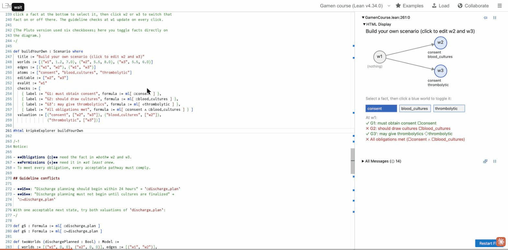

# gamen-lean

A Lean 4 port of [gamen-hs](https://github.com/chapmanbe/gamen-hs), a
framework for modal, temporal, epistemic, deontic, and STIT logic with
applications to clinical guideline validation, together with interactive
teaching notebooks that follow *Boxes and Diamonds*
([bd.openlogicproject.org](https://bd.openlogicproject.org)).

Named from Old English *gamen* (game, sport, joy).

**Status: early port.** The formula language, Kripke semantics, the prefixed
tableau for K (plus the D rules), the JSON protocol, and `gamen-validate`
are ported; `gamen-validate` answers identically to gamen-hs on every
request it supports. See [`PORTING.md`](PORTING.md) for the module-by-module
status and plan.

## Build

Install [elan](https://lean-lang.org/install), then:

```sh
lake build     # library, widgets, notebooks, gamen-validate
lake test      # unit, widget, notebook answer-key, and property tests
```

## Layout

| Path | Contents |
|---|---|
| `Gamen/` | The library: one module per gamen-hs module |
| `Validate.lean` | `gamen-validate`, the JSON Lines service used by guideline-validation, guideline-cds-simulation, patient-agent-assistant, and cwyde |
| `Widgets/` | Infoview widgets for the notebooks (clickable Kripke models, hints) |
| `Notebooks/` | Teaching notebooks ported from the Gamen.jl Pluto notebooks |
| `Tests/` | The test suite |
| `tools/compare/` | Side-by-side comparison of the gamen-hs and Lean `gamen-validate` |
| `web/` | Local web editor (lean4web) for the notebooks |
| `docs/assessment/` | The 2026-09-23 feasibility study that chose Lean |

## Notebooks

Open a file in `Notebooks/` in VS Code with the Lean 4 extension and put the
cursor on an `#eval` or `#html` line; results and diagrams appear in the
infoview. Or run them in a browser: `web/setup.sh` once, then
`web/run-local.sh` (localhost only; see `web/README.md`).

For health informatics students with no logic background, two notebooks
start from clinical rules: `PropLogicPrimer.lean` (truth tables, validity,
entailment) and then `ThreeValued.lean` (missing data, strong Kleene logic,
and why a CQL criterion can be null).



## License

MIT. `Widgets/js/interactiveSvgQuiet.js` is derived from ProofWidgets4
(Apache-2.0); see `Widgets/js/make-quiet.sh`.
